

  

<h1 align="center">Taka · টাকা</h1>

  <b>Every taka, every account, every source of income, in one simple app.</b> 
  A private, offline money manager built for Bangladesh, in Bangla and English.

  
  
  
  

  
  
  
   
  
  
  
  
  
  
  

<table align="center">
  <tr>
    <td align="center">
       
      v0.3.2 · APK, 81 MB · Android 8.0 or newer
    </td>
  </tr>
</table>

Free · <a href="https://github.com/abdullah-al-faahim/taka-releases/releases">All versions</a>

<b>iPhone:</b> the iOS version is in production and will be available very soon.

Formerly FinUtopia. Installing Taka over FinUtopia keeps all your data.

  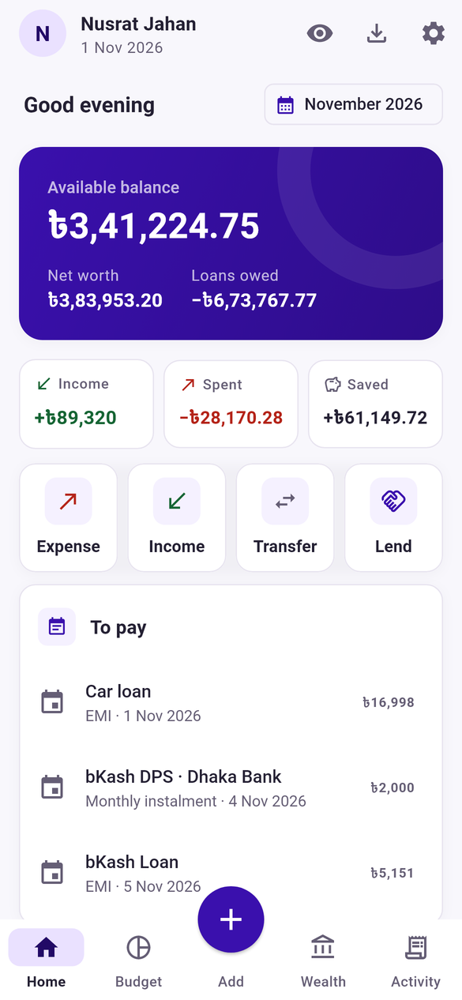
  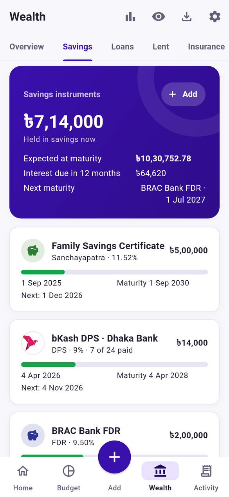
  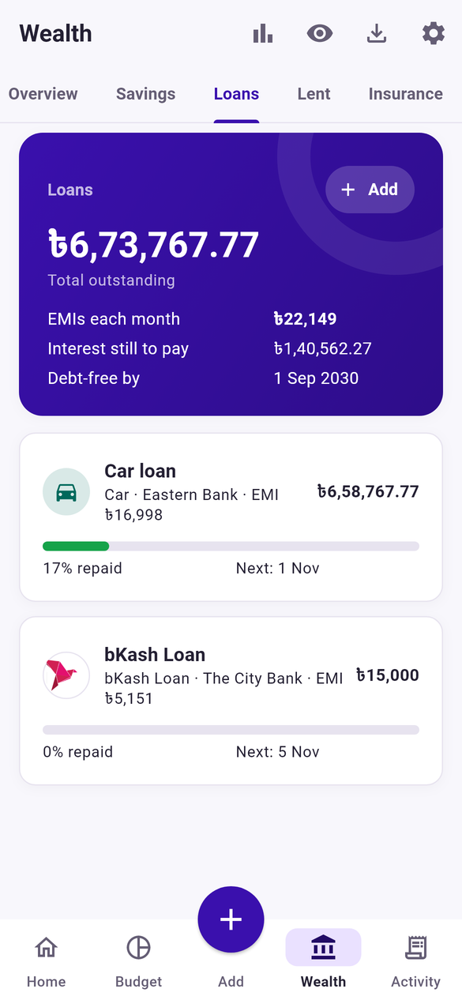

---

## Why Taka

Most money apps stop at "what did I spend today". Taka follows your whole financial life the
way it actually works in Bangladesh: cash in your pocket, bKash and Nagad on your phone, a salary
account, a DPS you pay every month, Sanchayapatra that pays you every month, an EMI you owe, and an
insurance premium coming up. It shows where you stand today and what is coming next.

- **Made for Bangladesh.** bKash, Nagad, Rocket, every major bank and the finance companies (NBFIs), with their logos. Amounts in
  lakh and crore (৳3,97,296). Sanchayapatra rate tables and tax bands, bank source tax and excise
  duty, and bKash DPS and bKash Loan built in.
- **Know what you can spend.** Home shows your available balance: the cash, wallet, bank and
  prepaid money you can use today, with your net worth just below.
- **Know where your money is safe.** The app warns you before a deposit goes above the Tk 2 lakh
  that is protected if a bank closes.
- **Your whole picture, not just spending.** Spending, budgets, savings, loans and insurance live
  in one place, and your net worth counts what you owe, not only what you have.
- **Tells you what's next.** EMIs, premiums and DPS instalments due this week sit on the Home
  screen, with reminders a day before. Savings show months left, interest to come and the maturity
  value.
- **Private by design.** No sign-up and no server. Your data stays on your phone in an encrypted
  database, behind an optional PIN or fingerprint. Backups are encrypted with a passphrase only
  you know, so even Google Drive can't read them.
- **Bangla first.** The whole app works in Bangla or English, with Bangla or English digits. The
  Bangla reads the way Bangladeshi banks and bKash talk, not like a translation.

## Key features

**Everyday money**
- Cash, mobile wallets (bKash, Nagad, Rocket, Upay and more), bank accounts, Rapid Pass and cards; 100+ providers with logos
- Credit, debit and prepaid cards: a debit card shows its bank account's balance, a credit card what you owe and what is left of the limit
- Dual currency cards: a separate dollar side with your own rate, and entries in taka or dollars
- Quick actions on Home: expense, income, transfer or lend in one tap; a big keypad shows amounts in words
- Bank and MFS cashback as income sources; categories for food, snacks and tea, and subscriptions
- Transfers with fees worked out for you: cash out, add money, bank to wallet
- Search and filter every entry by account, category, income source or date

**Budget and goals**
- Monthly budget with category limits and warnings at 80% and 100%
- "Safe to spend today" and a daily limit with a savings streak
- Goals with a target date and how much to put aside each month

**Savings that follow their whole life**
- DPS, FDR, savings accounts and the four Sanchayapatra schemes
- Rate tables by purchase date, tax bands per holder, gross, tax and net interest
- Progress to maturity, interest received and still to come, maturity value
- DPS instalments tracked one by one; plan future investments; encash or reinvest at maturity
- **Sanchayapatra tax by the law:** 5%/10% by your total until June 2026, a flat 10% advance tax from July 2026, with every rule and its source in the app
- **Profit straight to your bank:** monthly or quarterly profit is added to your bank account on its day, after tax
- **bKash DPS** with BRAC Bank, Dhaka Bank, Eastern Bank, IDLC, MTB and City Bank, paid from and back into bKash, monthly or weekly (from Tk 250 a week)
- **bKash FDR** with Eastern Bank or IDLC: Tk 10,000 to 1 lakh for 6 or 12 months, profit every 3 or 6 months into bKash
- **Finance companies:** the 30 NBFIs that take deposits (IDLC, IPDC, LankaBangla, DBH and more) for FDRs, DPSs and loans, with a caution on the nine Bangladesh Bank is winding up

**Deposit safety**
- A warning when an FDR or DPS would take you above the Tk 2 lakh protected per person per bank, or the bank was merged
- Banks and rates update online within a day, without an app update

**Loans and EMIs**
- Bank loans, card EMIs, money from family, already-running loans
- Reducing-balance or flat-rate EMI plan with principal and interest for every instalment
- Prepay and see the loan end sooner; debt-free date at a glance
- **bKash Loan** (City Bank): limits, 3–6 month tenure and the processing fee filled in

**Money you lend**
- Lend to friends or family without it counting as spending: it stays yours until it comes back
- See who owes you what, what is late and who is due back next; get it back in parts; send a polite reminder
- Write off what won't come back

**Insurance**
- Life, health, motor, property and travel policies
- Pick the insurer from all 82 IDRA-licensed companies (36 life, 46 general), with their logos, in Bangla or English
- Premium schedule, reminders, yearly renewals, maturity or claim payouts, total cover

**Reports for you and your tax return**
- Export any of the last 12 months as a designed PDF and an Excel workbook, or share both at once, straight from the Home screen
- Budget, spending, income, account balances, savings, loans, insurance, goals, next month's dues and every entry
- The Excel file keeps Bangla and puts each area on its own sheet, ready to sum and sort
- **Tax year summary** (July to June): income, interest with tax cut at source, investments, premiums, assets and debts on 30 June, and living expenses, ready for your return

**Edit anything**
- Change a loan, policy or savings plan any time: what you already paid stays, the rest is re-planned
- Move or change a single EMI, premium or instalment

**Your data, safely**
- Encrypted on the phone; app lock with PIN or fingerprint; hides amounts in recent apps
- Automatic encrypted backup to Google Drive or a folder, every day, week or month; restore everything on a new phone in a minute
- Your photo and name on Home; a clean, compact design in light and dark
- In-app updates for the app, banks and rates together, with a red dot when one is ready

## Screenshots

<table>
  <tr>
    <td align="center"> Home: available balance, quick actions, what to pay</td>
    <td align="center">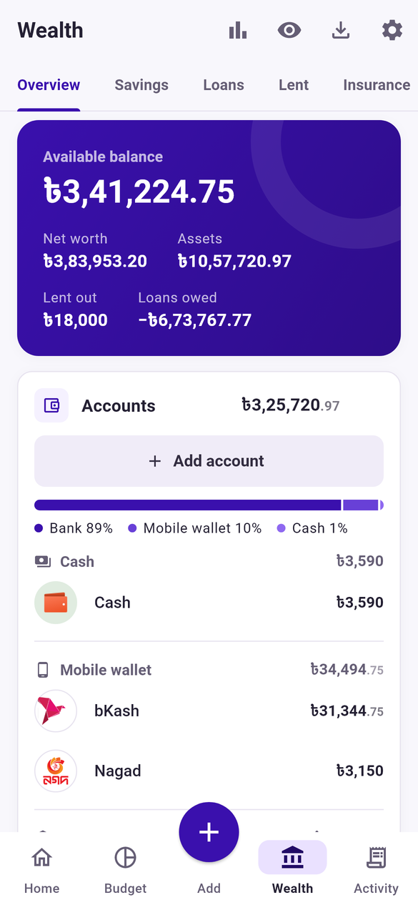 Wealth: assets and loans together</td>
    <td align="center"> Savings from start to maturity</td>
  </tr>
  <tr>
    <td align="center"> Loans with bKash Loan and EMIs</td>
    <td align="center">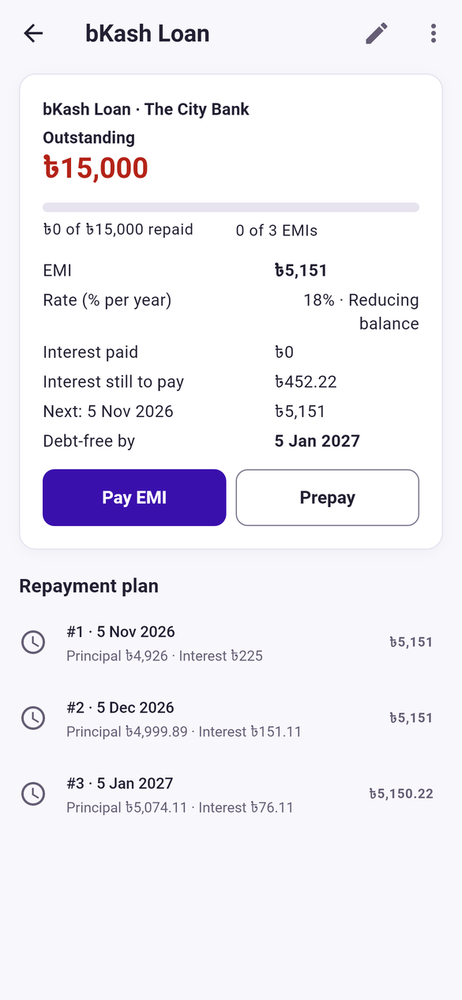 Every EMI split into principal and interest</td>
    <td align="center">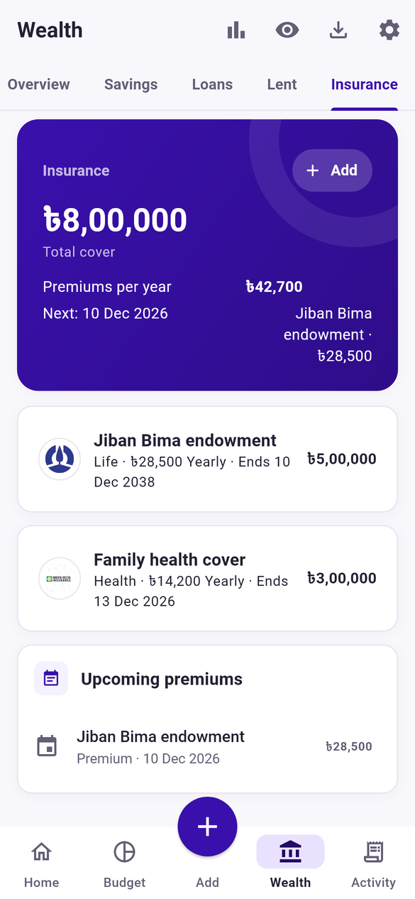 Insurance cover and premiums</td>
  </tr>
  <tr>
    <td align="center">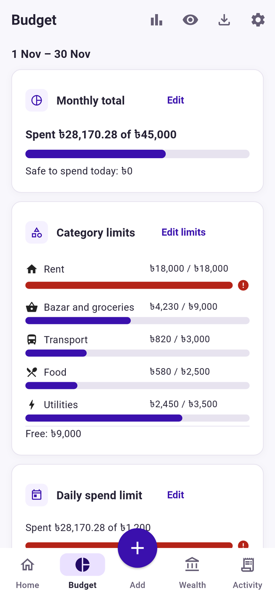 Budget with category limits</td>
    <td align="center">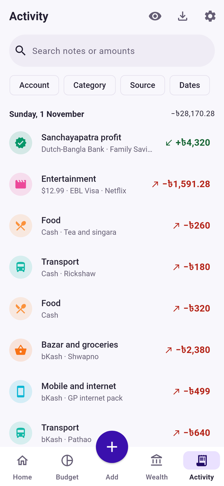 Every entry, searchable</td>
    <td align="center">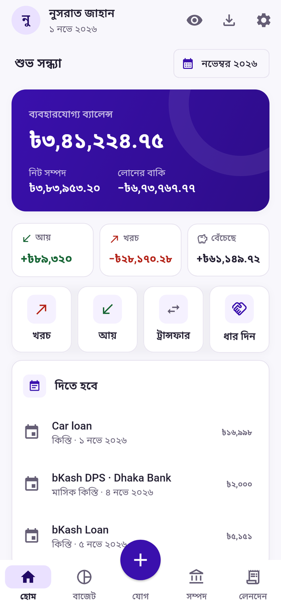 Fully in Bangla</td>
  </tr>
  <tr>
    <td align="center">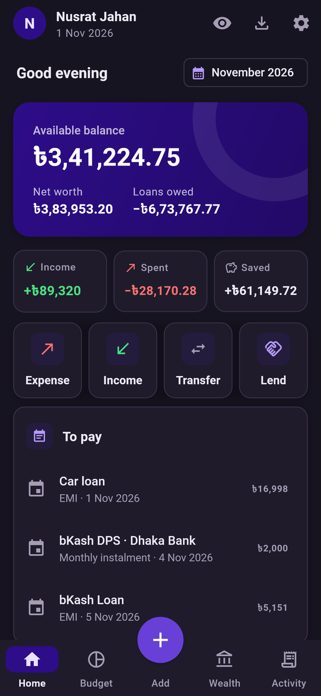 Dark theme</td>
    <td align="center">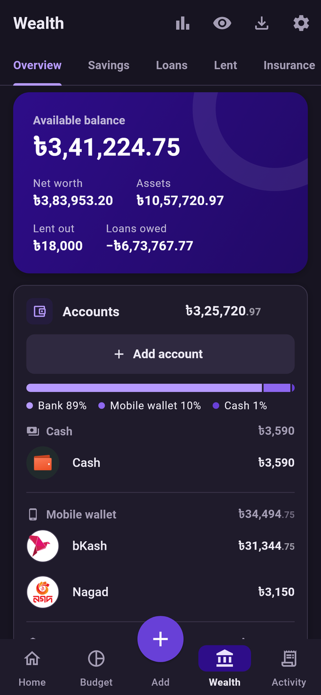 Dark theme: wealth</td>
    <td align="center">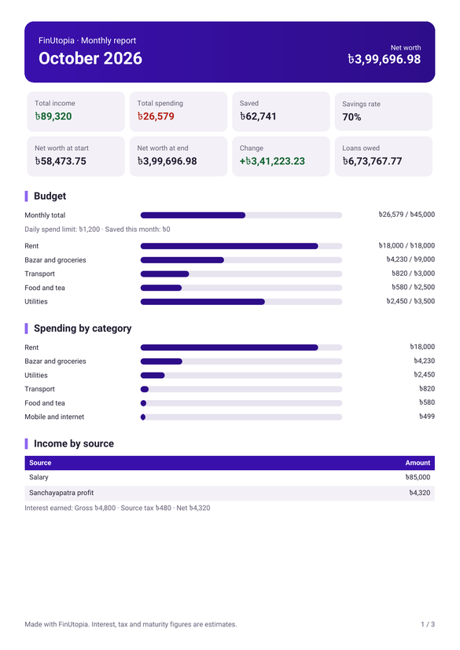 Monthly report as PDF (and Excel)</td>
  </tr>
  <tr>
    <td align="center">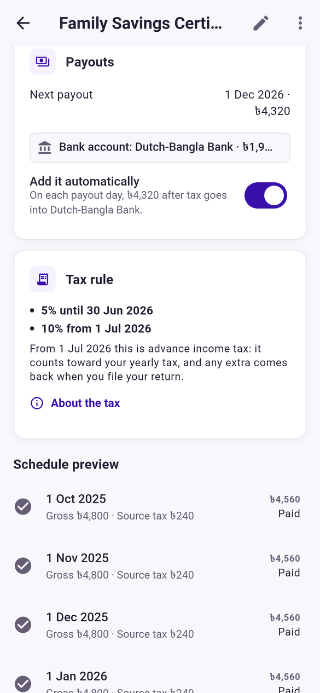 Sanchayapatra profit to your bank, tax by the law</td>
    <td align="center">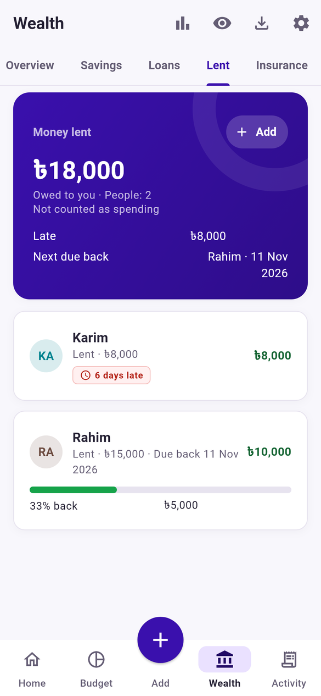 Money lent: who owes you, and what is late</td>
    <td align="center"> A warning above the Tk 2 lakh protected</td>
  </tr>
  <tr>
    <td align="center"> All licensed insurers to pick from</td>
  </tr>
</table>

## Install

1. On your Android phone, open the [latest release](https://github.com/abdullah-al-faahim/taka-releases/releases/latest)
   and download the `.apk` file.
2. Open it. If Android asks, allow your browser to install apps.
3. Pick Bangla or English and follow the short setup, or tap **Restore a backup** to bring your
   data from another phone.

**iPhone:** the iOS version is in production and will be available very soon. For now Taka
is for Android only.

**Updating:** Taka checks for new versions by itself. When one is out you'll see it on the Home
screen, or go to **Settings → App updates**. It installs over the current version and your data stays.

**Moving from Taka Tracker:** export an encrypted backup in Taka Tracker (Settings → Backup), then
choose **Restore a backup** on Taka's first screen.

## Privacy

Taka has no account and no server of its own. Everything you enter stays on your phone,
encrypted. Google Drive backup is optional: the file is encrypted with your passphrase before it
leaves the phone, and Taka can only see its own hidden backup folder, never your other files.
The only network calls are the optional backup and the daily update check.

## Good to know

- Interest, tax and EMI figures are careful estimates. Your bank, bKash or post office statement is
  the final word, and every figure can be edited.
- Taka is an independent app. It is not affiliated with bKash, City Bank or any bank, wallet or
  insurer shown. Their names and logos belong to their owners and are shown only to help you
  recognise your accounts.
- The source code is private; this repository hosts releases only.
